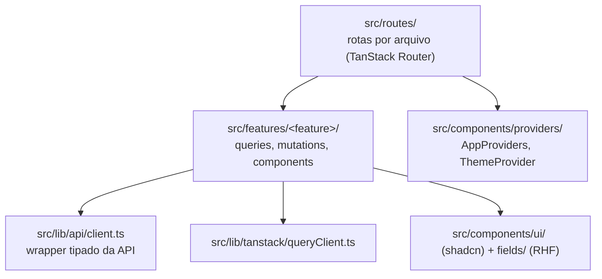

# Frontend: Vite + React

O `apps/web` é uma SPA em Vite + React, com rotas do TanStack Router e todo o estado de servidor no TanStack Query. Não há store global no cliente para dados do servidor: se veio da API, vive no cache de queries, não no estado de componentes.

## `src/routes/`

Um arquivo por rota, com roteamento baseado em arquivos do TanStack Router (`src/routeTree.gen.ts` é gerado: não edite à mão). `__root.tsx` é o layout raiz e `login.tsx` é a tela pública. As demais rotas ficam sob `_app.tsx`, a casca autenticada:

| Arquivo                | Rota         | Conteúdo                   |
| ---------------------- | ------------ | -------------------------- |
| `_app.index.tsx`       | `/`          | Quadro Kanban              |
| `_app.deals.index.tsx` | `/deals`     | Lista de negócios          |
| `_app.deals.$id.tsx`   | `/deals/:id` | Detalhe do negócio e notas |
| `_app.contacts.tsx`    | `/contacts`  | Contatos                   |
| `_app.dashboard.tsx`   | `/dashboard` | Painel de resumo           |

## `src/features/<feature>/`

Tudo sobre uma feature, no mesmo lugar: `queries/` e `mutations/` (TanStack Query), `components/`, `consts/` (por exemplo as chaves de query), `types.ts` e, quando necessário, `hooks/`, `contexts/` (como o `AuthContext`) e `utils/`. A UI compartilhada entre features fica em `src/components/`, não em uma pasta de feature.

Features atuais: `auth`, `contacts`, `deals`, `kanban`, `dashboard` e `onboarding` (o checklist "Primeiros passos").

## `src/lib/api/client.ts`

O único wrapper tipado das chamadas ao `apps/api`, com `get`, `post`, `patch` e `delete`. Uma resposta 401 em qualquer rota, exceto login e validação, limpa o cache e leva ao login. Ele importa tipos de erro como `ApiError` do `packages/contracts` e nunca deve reexportá-los: quem chama importa os tipos de contrato direto do `packages/contracts`, não por este arquivo.

## `src/lib/tanstack/queryClient.ts`

A instância compartilhada do `QueryClient` e seus padrões. Todo dado de servidor passa por ela: não use `useState` ou `useEffect` para guardar em cache algo que uma query já controla.

## `src/lib/`

Utilitários puros: `format.ts` (moeda em BRL e porcentagem) e `errors.ts`.

## `src/components/`

- `ui/`: primitivos do shadcn/ui. Trate como código de terceiros e estenda por composição, não editando.
- `fields/`: `GenericFormField`, `TextFormField`, `SelectFormField`, `TextareaFormField` e `CurrencyInput`. São os blocos obrigatórios dos campos de formulário: todo campo é React Hook Form com resolver do Zod por um destes componentes, nunca um input controlado por `useState`.
- `common/`: `ConfirmDialog`, `QueryState` (estados de carregando, erro e vazio) e `ProgressBar`.
- `layout/`: `AppShell`, com a navegação lateral e a saída da sessão.
- `brand/`: o `Logo` em SVG.
- `providers/`: `AppProviders` e `ThemeProvider` ao redor da raiz do app.

## `src/types/`

Cola de tipos específica do frontend (por exemplo `api.ts`). Os tipos de domínio ainda vêm do `packages/contracts`.
