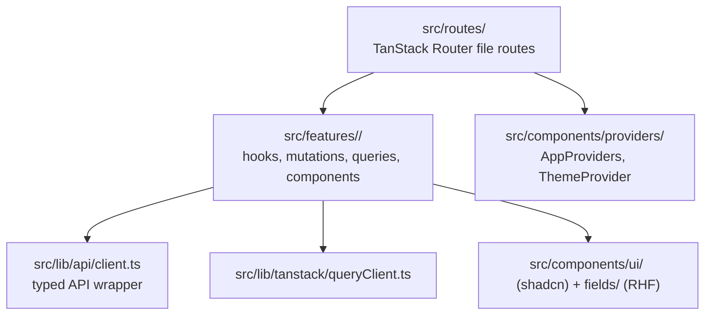

# Frontend: Vite + React

`apps/web` is a Vite + React SPA, routed with TanStack Router and using TanStack Query for all server state. There is no global client-side store for server data — if it came from the API, it lives in the query cache, not in component state.

## `src/routes/`

One file per route, file-based routing via TanStack Router (`src/routeTree.gen.ts` is generated — don't hand-edit it). `__root.tsx` is the layout shell; `_app.tsx`/`_app.index.tsx` are the authenticated app shell and its index page.

## `src/features/<feature>/`

Everything about one feature, colocated: `hooks/`, `queries/`, `mutations/` (TanStack Query), `contexts/` (e.g. `AuthContext`), `components/`, and feature-local `consts/` (e.g. query keys). Cross-feature shared UI goes in `src/components/` instead, not in a feature folder.

## `src/lib/api/client.ts`

The single typed wrapper around calls to `apps/api`. It imports error types like `ApiError` from `packages/contracts` — it must never re-export them; callers import contract types directly from `packages/contracts`, not through this file.

## `src/lib/tanstack/queryClient.ts`

The shared `QueryClient` instance and its defaults. All server data flows through it — don't reach for `useState`/`useEffect` to cache something a query already owns.

## `src/components/`

`ui/` is the shadcn/ui primitive set (treat as vendored — extend by composition, not by editing). `fields/` (`GenericFormField`, `TextFormField`) are the required building blocks for form fields: every form field is React Hook Form + a Zod resolver through one of these, never a raw `useState`-driven input. `providers/` wires `AppProviders`/`ThemeProvider` around the app root.

## `src/types/`

Frontend-specific type glue (e.g. `api.ts`). Domain types still come from `packages/contracts`.
