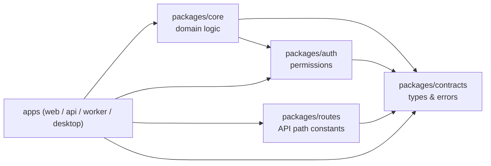

# Shared packages

`packages/` holds everything that must not exist twice. Every app (`web`, `api`/`desktop`, `worker`) imports from here instead of duplicating logic, types, or rules — this is what keeps them from drifting apart as the project grows.

## `packages/contracts`

The single source of truth for cross-cutting types: domain shapes (`users/types`), enums (`users/enums`), request/response envelopes (`requests/`), and typed error classes (`errors/`, plus one `errors/` folder per feature, e.g. `auth/errors`). Both frontend and backend import from here so a type only needs to change in one place.

## `packages/core`

Domain logic, organized by feature under `src/features/<feature>/`. Each feature splits into:

- `repository/` — persistence access (reads/writes against `packages/database`).
- `service/` — business rules, built on top of the repository.
- `consts/` — feature-local constants.

`core` never declares its own input/DTO types — those live in `packages/contracts` and `core` imports them. This keeps the domain layer decoupled from how a caller (HTTP body, RPC message) shaped the input.

## `packages/auth`

The permission matrix: `consts/roles.ts` and `consts/resources.ts` define what exists, `lib/can.ts` is the single function that decides whether a role can act on a resource. Nothing outside this package should reimplement a permission check.

## `packages/routes`

Route path constants shared between the app that defines an endpoint and the app that calls it (`src/routes/`), plus the helper that builds a path from a pattern and params (`utils/buildRoutes.ts`). Prevents route strings from drifting between frontend and backend.

## `packages/config`

Not runtime code — shared tooling presets consumed via each package's own config file: `tsconfig/` (TS presets for app/package/web), `eslint/`, `prettier/`, `vitest/` (node/web presets). A package opts in by extending the preset, not by copy-pasting config.
