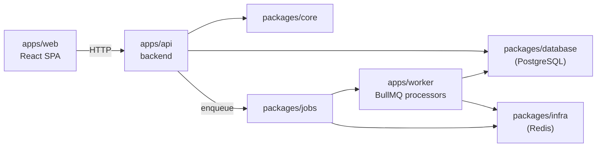

# Target: web

This project ships as a client/server split: a browser SPA, an HTTP API, and a background worker, backed by a real PostgreSQL instance. See [`packages.md`](./packages.md) for the packages every app below shares.

## `apps/web`

The frontend SPA. It only ever talks HTTP to `apps/api` — it has no direct access to the database, Redis, or job queues. See the `frontend-*.md` file in this folder for its internal structure.

## `apps/api`

The HTTP layer. Its own internal structure is documented in the `backend-*.md` file in this folder — this section only covers how it fits with the rest of the target. It delegates business logic to `packages/core`, checks permissions through `packages/auth`, reads/writes through `packages/database`, and enqueues async work through `packages/jobs` instead of doing it inline in a request handler.

## `apps/worker`

Runs everything that shouldn't block an HTTP response: job processors defined in `packages/jobs`, executed against BullMQ/Redis (`packages/infra`). Shares `packages/database` and `packages/infra` with `apps/api` — nothing about persistence or queue wiring is duplicated between the two runtimes; only the process that consumes the queue differs.

## `packages/database`

Drizzle schema and client, backed by a real PostgreSQL server. Every table follows a soft-delete convention (`deleted_at` + a partial unique index scoped to `deleted_at IS NULL`), and categorical columns (role, status, ...) are `pgEnum`, never `varchar` — check the schema files under `packages/database/src/schema` for the pattern before adding a table.

## `packages/infra`

Technical integrations that aren't domain logic — currently the Redis client (`src/redis/redis.ts`) that both `apps/api` (to enqueue) and `apps/worker` (to consume) connect through.

## `packages/jobs`

Shared queue definitions (`src/queues.ts`) and the helpers to enqueue (`utils/enqueue.ts`) or schedule repeatable jobs (`utils/scheduleRepeatable.ts`), plus the actual processors under `src/features/`. `apps/api` only enqueues; `apps/worker` is what registers processors via `utils/createWorkers.ts`.

## Deployment

The root `deploy` script (`pnpm run deploy`) pulls, installs, runs `packages/database`'s `db:deploy`, builds, and reloads `api`/`worker` through PM2 (`ecosystem.config.js`). There is no separate deploy step for `web` — its production build is served as static assets alongside `api`.
