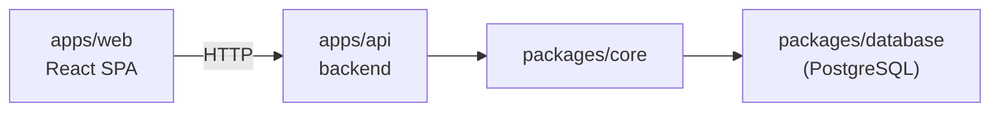

# Target: web

This project ships as a client/server split: a browser SPA and an HTTP API, backed by a real PostgreSQL instance. There are no background workers or queues. See [`packages.md`](./packages.md) for the packages every app below shares.

## `apps/web`

The frontend SPA. It only ever talks HTTP to `apps/api` — it has no direct access to the database. See the `frontend-*.md` file in this folder for its internal structure.

## `apps/api`

The NestJS HTTP layer. Every route requires a session (JWT in an httpOnly cookie) through a global `AuthGuard`, except those marked `@Public()` (`POST /auth/signin`, `GET /health/ping`). It delegates business logic to `packages/core`; only `core` reads/writes through `packages/database`. There is a single user role, so there is no permission matrix. Features: `stages`, `contacts`, `deals` (including `/stage` and `/status` transitions; `closedAt` is set on WON/LOST and cleared on OPEN), `notes` (only the author can delete) and `dashboard` (one SQL query with conditional aggregates; won/lost count deals whose `closedAt` falls in the current UTC month). Each feature has types, Zod schemas and errors in `packages/contracts`, a repository and service in `packages/core`, and a controller, module and DTOs in `apps/api`; paths live in `packages/routes`.

## `packages/database`

Drizzle schema and client, backed by PostgreSQL. Migrations live in `packages/database/migrations` and are generated with `db:generate <name>` and applied with `db:migrate`/`db:deploy`; schema changes only go through migrations. `src/seed.ts` is idempotent: it creates the single user from `SEED_USER_*` and upserts the four fixed funnel stages; `src/seed-demo.ts` (`db:seed:demo`) optionally adds demo contacts, deals and notes.

Tables: `users`, `stages`, `contacts`, `deals` (`value numeric(12,2)`, `deal_status` enum, contact FK `RESTRICT`, which the API turns into a 409 on contact delete) and `notes` (deal FK `CASCADE`, author FK to `users`).

## Deployment

The root `deploy` script (`pnpm run deploy`) pulls, installs, runs `packages/database`'s `db:deploy`, builds, and reloads `api` through PM2 (`ecosystem.config.js`). There is no separate deploy step for `web` — its production build is served as static assets. CI (`.github/workflows/ci.yml`) runs install, check-types, lint, format:check, test (against a Postgres service, migrated and seeded) and build on every push/PR.
