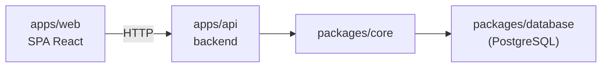

# Alvo: web

O projeto é entregue como uma separação cliente/servidor: uma SPA no navegador e uma API HTTP, com um PostgreSQL real por trás. Não há workers em segundo plano nem filas. Veja [`pacotes.md`](./pacotes.md) para os pacotes que todos os apps abaixo compartilham.

## `apps/web`

A SPA do frontend. Ela só fala HTTP com o `apps/api` e não tem acesso direto ao banco de dados. Veja [`frontend-vite.md`](./frontend-vite.md) para a estrutura interna.

## `apps/api`

A camada HTTP em NestJS. Toda rota exige sessão (JWT em cookie httpOnly) por meio de um `AuthGuard` global, exceto as marcadas com `@Public()` (`POST /auth/signin` e `GET /health/ping`). Ela delega a lógica de negócio ao `packages/core`, e só o `core` lê e escreve pelo `packages/database`. Há um único papel de usuário, então não existe matriz de permissões.

Features: `stages`, `contacts`, `deals` (incluindo as transições `/stage` e `/status`; `closedAt` é preenchido ao marcar GANHO ou PERDIDO e limpo ao reabrir), `notes` (só o autor pode excluir) e `dashboard` (uma única consulta SQL com agregados condicionais; ganhos e perdidos contam os negócios cujo `closedAt` cai no mês UTC atual).

Cada feature tem tipos, esquemas Zod e erros em `packages/contracts`, repositório e serviço em `packages/core`, e controller, módulo e DTOs em `apps/api`. Os caminhos ficam em `packages/routes`.

## `packages/database`

Esquema e cliente do Drizzle, sobre PostgreSQL. As migrações ficam em `packages/database/migrations`, são geradas com `db:generate <nome>` e aplicadas com `db:migrate` ou `db:deploy`. Mudanças de esquema só passam por migrações.

O `src/seed.ts` é idempotente: cria o único usuário a partir de `SEED_USER_*` e faz upsert dos quatro estágios fixos do funil. O `src/seed-demo.ts` (`db:seed:demo`) adiciona, opcionalmente, contatos, negócios e notas de demonstração.

Tabelas:

- `users`
- `stages`
- `contacts`
- `deals`: `value numeric(12,2)`, enum `deal_status` e FK de contato `RESTRICT`, que a API transforma em 409 ao excluir um contato com negócios.
- `notes`: FK de negócio `CASCADE` e FK de autor para `users`.

## Publicação

O script `deploy` da raiz (`pnpm run deploy`) faz pull, instala, roda o `db:deploy` do `packages/database`, compila e recarrega a `api` pelo PM2 (`ecosystem.config.js`). Não há etapa de deploy separada para o `web`: o build de produção dele é servido como arquivos estáticos.

O CI (`.github/workflows/ci.yml`) roda instalação, check-types, lint, format:check, testes (contra um serviço Postgres, migrado e populado) e build a cada push ou PR.
