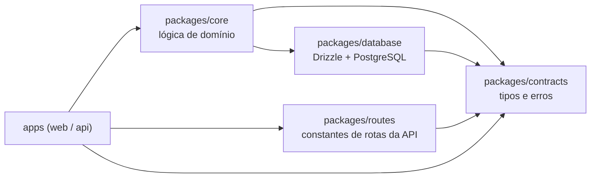

# Pacotes compartilhados

`packages/` concentra tudo o que não pode existir duas vezes. Cada app (`web`, `api`) importa daqui em vez de duplicar lógica, tipos ou regras. É isso que impede que eles se desencontrem conforme o projeto cresce.

## `packages/contracts`

A fonte única da verdade para os tipos transversais: formatos de domínio (por exemplo `users/types`), envelopes de requisição e resposta (`requests/`) e classes de erro tipadas (`errors/`, mais uma pasta `errors/` por feature, como `auth/errors`). Frontend e backend importam daqui, então um tipo só precisa mudar em um lugar.

## `packages/core`

Lógica de domínio, organizada por feature em `src/features/<feature>/`. Cada feature se divide em:

- `repository/`: acesso à persistência (leituras e escritas em `packages/database`).
- `service/`: regras de negócio, construídas sobre o repositório.
- `consts/`: constantes locais da feature.

O `core` nunca declara seus próprios tipos de entrada/DTO. Eles ficam em `packages/contracts` e o `core` os importa. Isso mantém a camada de domínio desacoplada da forma como quem chama (corpo HTTP, mensagem RPC) montou a entrada.

## `packages/database`

Esquema e cliente do Drizzle sobre PostgreSQL, com migrações versionadas e os scripts de seed. Detalhes em [`alvo-web.md`](./alvo-web.md).

## `packages/routes`

Constantes de caminhos de rota compartilhadas entre o app que define um endpoint e o app que o chama (`src/routes/`), mais o utilitário que monta um caminho a partir de um padrão e de parâmetros (`utils/buildRoutes.ts`). Evita que as strings de rota se desencontrem entre frontend e backend.

## `packages/config`

Não é código de execução: são presets de ferramentas compartilhados, consumidos pelo arquivo de configuração de cada pacote: `tsconfig/` (presets de TS para app, pacote e web), `eslint/`, `prettier/` e `vitest/` (presets para node e web). Um pacote adere estendendo o preset, não copiando e colando a configuração.
